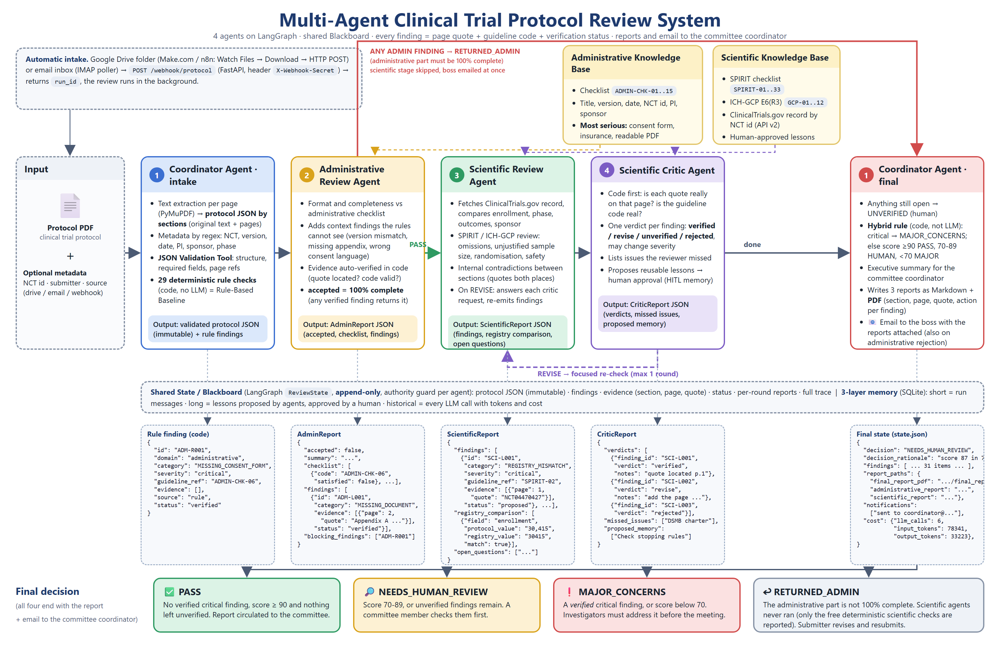
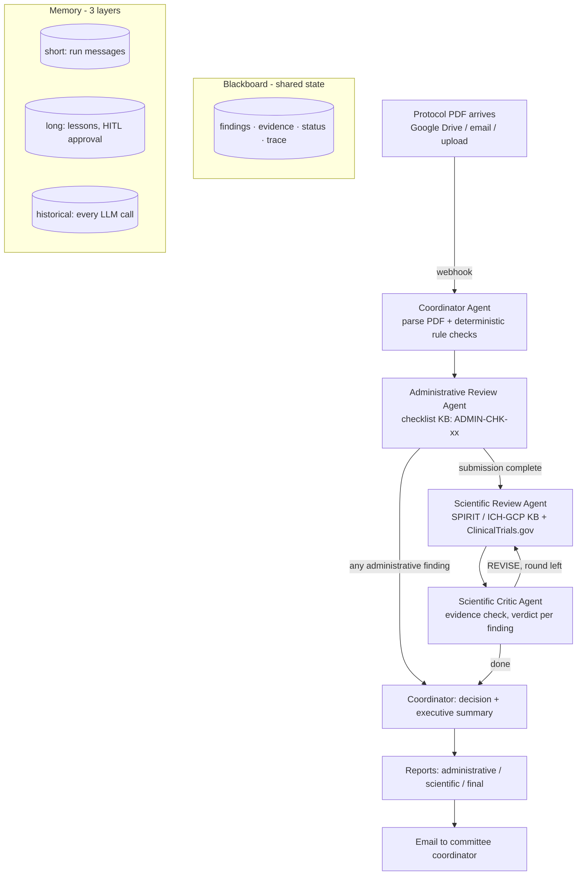

# Multi-Agent Clinical Trial Protocol Review System

BIU DS23 final project - Amir Shmaryahu and Ron Levi.

An automated, multi-agent pipeline that screens clinical trial protocols (PDF) for a
Helsinki (IRB) committee coordinator: administrative completeness first, then scientific
review with an independent critic, with every finding tied to a page quote and a
guideline reference. Protocols arrive automatically (Google Drive / email webhook),
reports and an executive summary are emailed to the coordinator. The system **supports,
but does not replace,** professional committee review.

## 1. Architecture



*Source: `docs/architecture.html` (render with headless Edge/Chrome, `--window-size=1600,1060 --screenshot`).*



**Flow in words**

1. **Trigger.** A PDF reaches `POST /webhook/protocol` (multipart) or `POST /webhook/protocol-url`
   (JSON with a download link) from Make.com / n8n / Google Drive, or is picked from an IMAP inbox
   by the poller. The API answers immediately with a `run_id`; the review runs in the background.
2. **Coordinator - intake.** Extracts text per page (PyMuPDF), regex metadata (title, version, date,
   NCT id, PI, sponsor, phase), builds the **structured protocol JSON** (sections with original text and
   page ranges, `protocol_json.py`) and runs the **deterministic rule checks** (shared with the baseline).
   The **JSON Validation Tool** then checks structure, required fields and page references; an invalid
   document is returned immediately (finding `ADM-V001`), no agent is called.
3. **Administrative Review Agent.** Receives the administrative checklist (knowledge base), approved
   lessons from memory, the rule findings and the full protocol text. Returns a structured
   `AdminReport` (accepted?, checklist, extra findings). The administrative part must be 100% complete:
   any verified administrative finding (the most serious being no consent form,
   no insurance, unreadable PDF) stops the pipeline: the coordinator emails the boss the administrative
   report and the submission is **RETURNED_ADMIN**.
4. **Scientific Review Agent.** Fetches the ClinicalTrials.gov record by NCT id (API v2), compares it
   with the protocol, and reviews against SPIRIT / ICH-GCP. Returns a `ScientificReport` with findings,
   a registry comparison table and open questions.
5. **Scientific Critic Agent.** First the code verifies each finding's evidence (is the quoted text really
   on that page? is the guideline code real?). The critic then returns one verdict per finding:
   **verified / revise / unverified / rejected**. `revise` sends focused requests back to the reviewer
   (bounded: `MAX_REVISE_ROUNDS`, default 1). A critic cannot mark a finding verified when its quote was
   not found in the PDF (guardrail). Reusable lessons are **proposed** to long-term memory.
6. **Coordinator - finalize.** Decision = `PASS` | `RETURNED_ADMIN` | `MAJOR_CONCERNS` |
   `NEEDS_HUMAN_REVIEW`, an executive summary, three markdown reports, and an email to the boss with
   the reports attached.

**Agents, tools and output formats**

| Agent | Tools | Output (pydantic, enforced by structured outputs) |
|---|---|---|
| Coordinator | PDF parser, rule checks, SQLite memory, SMTP | routing decisions, `FinalSummary` |
| Administrative Review | admin checklist KB, memory recall | `AdminReport` |
| Scientific Review | SPIRIT/GCP KB, ClinicalTrials.gov client, registry comparison | `ScientificReport` |
| Scientific Critic | evidence verifier (fuzzy quote search), KB code validation | `CriticReport` |

The charter also lists an *Administrative Critic*; this implementation follows the original
four-agent structure (coordinator, administrative, scientific reviewer, scientific critic) and
replaces the administrative critic with automatic evidence verification of the admin agent's
findings. Adding a fifth LLM critic is one extra node in `graph.py`.

**Rule-Based Baseline (Checkpoint 1).** `protocol_review.baseline` runs only the deterministic checks
(no LLM) and emits the same `Finding` format and decisions, so `eval/evaluate.py` compares baseline vs
agents on the same labeled cases.

**Three-layer memory (platform standard).**
- *short*: the agents' conversation on the blackboard per run (`run_messages`, `GET /runs/{id}/messages`).
- *long*: lessons agents propose; a human approves / edits / rejects via `/memory/*`; only approved
  facts are injected into prompts (global scope never auto-approves).
- *historical*: every LLM exchange with tokens, duration and output (`agent_interactions`,
  `GET /runs/{id}/cost`) for audit, cost tracking and evaluation.

## 2. Repository layout

```
src/protocol_review/
  api.py              FastAPI webhooks, run inspection, memory HITL endpoints
  cli.py              review [--force-scientific --no-critic] / baseline / single [--no-verification] / serve / poll-mail / graph
  graph.py            LangGraph wiring (nodes + conditional edges)
  pipeline.py         run_review(), run_baseline()
  baseline.py         rule-based baseline
  state.py            Blackboard models: Finding, AdminReport, ScientificReport, CriticReport ...
  llm.py              Anthropic SDK wrapper (structured outputs, refusal fallbacks) + MockLLM
  pdf_parser.py       PyMuPDF extraction + regex metadata
  protocol_json.py    structured protocol JSON by sections + JSON Validation Tool
  scoring.py          derived score + hybrid decision rule
  knowledge_base.py   KB loader + keyword retrieval
  memory.py / db.py   3-layer memory (SQLite via SQLAlchemy)
  reports.py          Markdown + PDF reports (xhtml2pdf)     notify.py  email with PDFs (SMTP / dry-run .eml)
  agents/             coordinator, administrative, scientific_reviewer, scientific_critic, prompts
  tools/              checks.py (deterministic), clinicaltrials.py (registry API)
  ingest/imap_poller.py
knowledge_base/       administrative/admin_checklist.md, scientific/spirit_checklist.md, ich_gcp_key_points.md
samples/              make_sample_protocols.py -> two synthetic PDFs (good / flawed)
eval/                 labeled_cases/*.json, evaluate.py, matching.py (locked matching rule), category_aliases.json, ablation.py
reports/results.md    4-row ablation table written by eval/ablation.py
tests/                31 pytest tests (MockLLM, no network)
outputs/<run_id>/     final_report.md/.pdf, administrative_report.md/.pdf, scientific_report.md/.pdf, protocol.json, findings.json, state.json, email.eml
```

## 3. Setup

```bash
python -m venv .venv
.venv/Scripts/python -m pip install -e .          # Windows; use .venv/bin/python on Linux/macOS
copy .env.example .env                            # then fill ANTHROPIC_API_KEY, BOSS_EMAIL, SMTP_*
.venv/Scripts/python samples/make_sample_protocols.py
.venv/Scripts/python -m pytest
```

Windows note: Smart App Control blocks venv `.exe` stubs, so always call tools as
`python -m uvicorn`, `python -m pytest`, etc.

Model: `LLM_MODEL=claude-opus-5-5` by default (set `claude-sonnet-5-5` for cheaper runs). Server-side
refusal fallbacks are enabled (`LLM_FALLBACKS=true`); set `false` when running through Bedrock / Vertex.
`NO_LLM=true` runs the full graph with deterministic checks only.

## 4. Running

```bash
# full multi-agent review from the command line
.venv/Scripts/python -m protocol_review.cli review samples/synthetic_protocol_flawed.pdf

# rule-based baseline only
.venv/Scripts/python -m protocol_review.cli baseline samples/synthetic_protocol_flawed.pdf

# webhook server (http://127.0.0.1:8040/docs)
.venv/Scripts/python -m uvicorn protocol_review.api:app --port 8040

# email inbox poller
.venv/Scripts/python -m protocol_review.cli poll-mail

# evaluation
.venv/Scripts/python eval/evaluate.py --mode baseline
.venv/Scripts/python eval/evaluate.py --mode agents --force-scientific
.venv/Scripts/python eval/ablation.py --no-llm          # 4-row ablation table -> reports/results.md (see section 6)
```

### API

| Method | Path | Purpose |
|---|---|---|
| POST | `/webhook/protocol` | multipart `file` (+ `nct_id`, `submitter`, `source`) -> `{run_id}` |
| POST | `/webhook/protocol-url` | JSON `{file_url, nct_id, submitter, source}` (Drive link) |
| POST | `/baseline` | synchronous rule-based baseline |
| GET | `/runs`, `/runs/{id}` | run list / full state and decision |
| GET | `/runs/{id}/report?kind=final|admin|scientific` | markdown report |
| GET | `/runs/{id}/messages`, `/runs/{id}/cost` | short memory, token usage |
| GET | `/memory?status=proposed` | lessons awaiting human approval |
| POST | `/memory/{id}/approve` · `/reject` · `/deactivate` | HITL decisions (`{"decided_by": "...", "fact": "optional edit"}`) |

Write endpoints require the header `X-Webhook-Secret: <WEBHOOK_SECRET>`.

## 5. Connecting the automation (Make.com / n8n / Google Drive)

**Expose the server.** Run the API on a host reachable from the internet (VPS, or locally with
`ngrok http 8040` during development) and note the public URL, e.g. `https://abc.ngrok.app`.

**Make.com scenario**
1. Trigger: *Google Drive -> Watch Files in a Folder* (the committee's intake folder), filter
   `File type = PDF`.
2. *Google Drive -> Download a File* (returns the binary).
3. *HTTP -> Make a request*: `POST https://abc.ngrok.app/webhook/protocol`, body type
   *Multipart/form-data*; field `file` = the downloaded data (file name from step 1); optional text
   fields `submitter` (file owner email), `nct_id` (if your folder convention carries it);
   header `X-Webhook-Secret` = your secret.
4. Optional: *Google Drive -> Move a File* to a "processed" folder, and store the returned
   `run_id` in a Google Sheet.

**n8n workflow**
`Google Drive Trigger (fileCreated, folder) -> Google Drive (download) -> HTTP Request`
(method POST, *Send Body* = Form-Data Multipart, parameter type *n8n Binary File*, field name `file`;
header `X-Webhook-Secret`). Alternatively send JSON to `/webhook/protocol-url` with the file's
`webContentLink` when the file is shared with "anyone with the link".

**Email intake without an automation platform.** Create a mailbox for submissions, set
`IMAP_HOST/USER/PASSWORD` in `.env` and run `python -m protocol_review.cli poll-mail`; every unseen
message with a PDF attachment starts a review (an NCT id in the subject is picked up automatically).

**Outgoing email.** The coordinator's summary and the reports go to `BOSS_EMAIL` via SMTP
(`SMTP_*`). With `EMAIL_DRY_RUN=true` the message is written to `outputs/<run_id>/email.eml` instead.

## 6. Evaluation

Labeled cases live in `eval/labeled_cases/*.json`: expected findings (`domain`, `category`, optionally
`guideline_ref` and `page`) plus the expected decision. `eval/evaluate.py` runs the baseline, the single agent
or the agents, scores precision / recall / F1, precision of **verified** findings and the unverified count
(critic-rejected and withdrawn findings are not predictions), and records runtime and tokens. Current synthetic
cases: one complete protocol (any finding = false positive) and one with ten documented injected deficiencies.

**Matching rule (charter v1.4, `eval/matching.py`).** A predicted finding matches a labeled one when the domain is
the same and either the categories are the same or aliases (`eval/category_aliases.json`), or the guideline
reference is the same and the page is within ±1.

### Evaluation modes

Public protocols rarely include consent forms or insurance certificates, so in production nearly every one is
`RETURNED_ADMIN` and the scientific agents never run. Three switches exist for evaluation only:

| Flag | Where | Effect |
|---|---|---|
| `--force-scientific` | `cli.py review`, `eval/evaluate.py --mode agents`, `run_review(force_scientific=True)` | gate bypass: the scientific stage runs even when the administrative gate fails; the decision is still `RETURNED_ADMIN`, the scientific findings are produced, scored and reported (score scope `full_forced`) |
| `--no-critic` | `cli.py review`, `eval/evaluate.py --mode agents`, `run_review(no_critic=True)` | ablation: the Scientific Critic (and the revision round) is skipped; the reviewer's findings are verified by code only, exactly like the single agent's |
| `--no-verification` | `cli.py single`, `eval/evaluate.py --mode single`, `run_single_agent(verify=False)` | ablation: no code-level evidence check; the model's own status stands (unmarked findings count as verified) |

**Ablation runner.** `eval/ablation.py` runs the four Checkpoint 2 configurations on every labeled case (all with
the gate bypass) and writes `reports/results.md`: single agent without code verification, single agent with it,
full system without the critic, full system. Columns: precision of verified findings, recall (coverage) of
labeled findings, unverified count, LLM calls, input / output tokens, runtime; a JSON copy goes to `eval/results/`.

```bash
.venv/Scripts/python eval/ablation.py                 # live (ANTHROPIC_API_KEY), 4 x N reviews
.venv/Scripts/python eval/ablation.py --no-llm        # dry run with the MockLLM: harness check, no API calls
.venv/Scripts/python eval/ablation.py --no-registry --only agents_full   # skip ClinicalTrials.gov / one row
```

Baseline on the synthetic cases (live ClinicalTrials.gov): flawed F1 = 1.00 (10/10 injected
deficiencies found), good 0 false positives. These are development numbers, not the project's
evaluation results; the real evaluation uses public protocols labeled by the team (Checkpoint 2).

## 6b. Decision rules and derived score

**Administrative rule:** the administrative part must be 100% complete; any verified administrative
finding (except `info`) returns the submission (RETURNED_ADMIN) and the scientific agents do not run.

**Scientific rule (hybrid, team decision 2026-10-19, `scoring.hybrid_decision`):** any verified
**critical** finding -> MAJOR_CONCERNS regardless of score; otherwise the derived score decides:
`>= SCORE_PASS_MIN` (90) PASS, `SCORE_HUMAN_MIN..SCORE_PASS_MIN-1` (70-89) NEEDS_HUMAN_REVIEW,
below MAJOR_CONCERNS. Unverified findings prevent an automatic PASS. Thresholds are in `.env`.
The rule that fired is stored as `decision_rationale` and printed in the report.

**Score** (`scoring.compute_score`): start at 100, subtract 25 per verified critical, 10 per major,
3 per minor finding, floor at 0. Unverified findings are not counted but shown as pending human
review; rejected and withdrawn ones are ignored. Every deduction is listed by finding id.

**Agent authority guard** (`graph.guarded`): each node may write only its permitted ReviewState keys;
the protocol data is writable at intake only; the Coordinator cannot alter agent reports or findings.
A violation raises `AuthorityViolation` and fails the run. **Append-only state:** findings a reviewer
drops in a revision round stay as `withdrawn`; every round's reports are kept in
`scientific_reports` / `critic_reports`.

## 7. Guardrails and failure handling

- Structured outputs validate every agent response; invalid JSON is retried once with the error.
- `stop_reason == "refusal"` is handled; server-side fallbacks re-run declined requests.
- LLM failures degrade to deterministic results and are listed in the report (`errors`).
- A finding is never `verified` unless its quote is located in the PDF; unknown guideline codes are flagged.
- Bounded revision loop; anything still open at finalisation becomes `UNVERIFIED` -> human review.
- Full trace of agent actions and decisions in `state.json` and the final report.

## 8. Roadmap (from the charter)

- Checkpoint 1 (18 Oct): end-to-end pipeline + rule-based baseline - **this repository**.
- 20 Oct (charter v1.4, mentor review): locked primary metric and matching rule, evaluation gate bypass,
  ablation switches and runner (`eval/ablation.py` -> `reports/results.md`) - **done**.
- Checkpoint 2 (30 Oct): verified SPIRIT 2025 / ICH-GCP E6(R3) knowledge base, real public protocols,
  blind labeled findings (Ron), ablation table on the real set, 30-finding human check, demo video.
- Final (12 Nov): evaluation vs rule-based and single-agent baselines, results and presentation.
