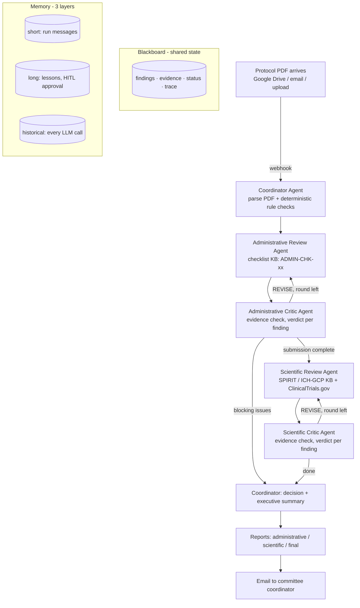

# Multi-Agent Clinical Trial Protocol Review System

BIU DS23 final project - Amir Shmaryahu and Ron Levi.

An automated, multi-agent pipeline that screens clinical trial protocols (PDF) for a
Helsinki (IRB) committee coordinator: administrative completeness first, then scientific
review with an independent critic, with every finding tied to a page quote and a
guideline reference. Protocols arrive automatically (Google Drive / email webhook),
reports and an executive summary are emailed to the coordinator. The system **supports,
but does not replace,** professional committee review.

## 1. Architecture



**Flow in words**

1. **Trigger.** A PDF reaches `POST /webhook/protocol` (multipart) or `POST /webhook/protocol-url`
   (JSON with a download link) from Make.com / n8n / Google Drive, or is picked from an IMAP inbox
   by the poller. The API answers immediately with a `run_id`; the review runs in the background.
2. **Coordinator - intake.** Extracts text per page (PyMuPDF), regex metadata (title, version, date,
   NCT id, PI, sponsor, phase) and runs the **deterministic rule checks** (shared with the baseline).
3. **Administrative Review Agent.** Receives the administrative checklist (knowledge base), approved
   lessons from memory, the rule findings and the full protocol text. Returns a structured
   `AdminReport` (accepted?, checklist, extra findings). Its own findings start as **proposed**;
   only the rule findings are verified by construction.
4. **Administrative Critic Agent.** Mirrors the scientific critic for the administrative domain: the
   code first checks each finding's evidence (quote located in the PDF? ADMIN-CHK code real?), then the
   critic returns one verdict per finding: **verified / revise / unverified / rejected**. `revise` sends
   focused requests back to the administrative agent (bounded: `MAX_REVISE_ROUNDS`, default 1, tracked
   separately as `admin_revise_rounds`). The critic cannot mark a finding verified when its quote was
   not found (guardrail). It then recomputes the administrative decision: a *verified* critical finding
   (no consent form, no insurance, unreadable PDF) blocks the submission even if the admin agent said
   "accepted", and a *rejected* one never blocks. Blocking failures stop the pipeline: the coordinator
   emails the boss the administrative report and the submission is **RETURNED_ADMIN**.
5. **Scientific Review Agent.** Fetches the ClinicalTrials.gov record by NCT id (API v2), compares it
   with the protocol, and reviews against SPIRIT / ICH-GCP. Returns a `ScientificReport` with findings,
   a registry comparison table and open questions.
6. **Scientific Critic Agent.** First the code verifies each finding's evidence (is the quoted text really
   on that page? is the guideline code real?). The critic then returns one verdict per finding:
   **verified / revise / unverified / rejected**. `revise` sends focused requests back to the reviewer
   (bounded: `MAX_REVISE_ROUNDS`, default 1). A critic cannot mark a finding verified when its quote was
   not found in the PDF (guardrail). Reusable lessons are **proposed** to long-term memory.
7. **Coordinator - finalize.** Decision = `PASS` | `RETURNED_ADMIN` | `MAJOR_CONCERNS` |
   `NEEDS_HUMAN_REVIEW`, an executive summary, three markdown reports, and an email to the boss with
   the reports attached.

**Agents, tools and output formats**

| Agent | Tools | Output (pydantic, enforced by structured outputs) |
|---|---|---|
| Coordinator | PDF parser, rule checks, SQLite memory, SMTP | routing decisions, `FinalSummary` |
| Administrative Review | admin checklist KB, memory recall | `AdminReport` |
| Administrative Critic | evidence verifier (fuzzy quote search), KB code validation, memory proposals | `AdminCriticReport` |
| Scientific Review | SPIRIT/GCP KB, ClinicalTrials.gov client, registry comparison | `ScientificReport` |
| Scientific Critic | evidence verifier (fuzzy quote search), KB code validation, memory proposals | `CriticReport` |

This is the five-agent structure of the charter (coordinator, administrative reviewer, administrative
critic, scientific reviewer, scientific critic). Both critics share the same verdict vocabulary, the
same code-level evidence check and the same bounded revision loop; each proposes lessons to long-term
memory under its own agent name, so the human approves them separately.

**Baselines for the evaluation.** Both emit the same `Finding` format and decision vocabulary as the
multi-agent pipeline, so `eval/evaluate.py` scores all three on the same labeled cases.
- *Rule-Based Baseline (Checkpoint 1).* `protocol_review.baseline` runs only the deterministic checks
  (no LLM).
- *Single-Agent Baseline.* `protocol_review.single_agent` makes **one** Claude call (same model, same
  `LLM.structured` wrapper) with everything the multi-agent system has: the full protocol text with
  page markers, both knowledge-base domains, the deterministic rule findings, the ClinicalTrials.gov
  summary and the approved memories. It returns a `SingleAgentReport` (both domains in one findings
  list, checklist, registry comparison, executive summary). The same evidence verification is applied
  (an unlocated quote or unknown guideline code makes a finding `unverified`) and the same decision
  rule as the coordinator, but there is no critic and no revision round - that difference is what the
  comparison measures.

**Three-layer memory (platform standard).**
- *short*: the agents' conversation on the blackboard per run (`run_messages`, `GET /runs/{id}/messages`).
- *long*: lessons agents propose; a human approves / edits / rejects via `/memory/*`; only approved
  facts are injected into prompts (global scope never auto-approves).
- *historical*: every LLM exchange with tokens, duration and output (`agent_interactions`,
  `GET /runs/{id}/cost`) for audit, cost tracking and evaluation.

## 2. Repository layout

```
src/protocol_review/
  api.py              FastAPI webhooks, run inspection, memory HITL endpoints
  cli.py              review / baseline / single / serve / poll-mail / graph
  graph.py            LangGraph wiring (nodes + conditional edges)
  pipeline.py         run_review(), run_baseline(), run_single_agent()
  baseline.py         rule-based baseline
  single_agent.py     single-agent baseline (one LLM call, all tools and data)
  state.py            Blackboard models: Finding, AdminReport, AdminCriticReport, ScientificReport, CriticReport, SingleAgentReport ...
  llm.py              Anthropic SDK wrapper (structured outputs, refusal fallbacks) + MockLLM
  pdf_parser.py       PyMuPDF extraction + regex metadata
  knowledge_base.py   KB loader + keyword retrieval
  memory.py / db.py   3-layer memory (SQLite via SQLAlchemy)
  reports.py          markdown reports     notify.py  email (SMTP / dry-run .eml)
  agents/             coordinator, administrative, administrative_critic, scientific_reviewer, scientific_critic, prompts
  tools/              checks.py (deterministic), clinicaltrials.py (registry API)
  ingest/imap_poller.py
knowledge_base/       administrative/admin_checklist.md, scientific/spirit_checklist.md, ich_gcp_key_points.md
samples/              make_sample_protocols.py -> two synthetic PDFs (good / flawed)
eval/                 labeled_cases/*.json, evaluate.py (P/R/F1, runtime, tokens)
tests/                21 pytest tests (MockLLM, no network)
outputs/<run_id>/     final_report.md, administrative_report.md, scientific_report.md, findings.json, state.json, email.eml
```

## 3. Setup

```bash
python -m venv .venv
.venv/Scripts/python -m pip install -e .          # Windows; use .venv/bin/python on Linux/macOS
copy .env.example .env                            # then fill ANTHROPIC_API_KEY, BOSS_EMAIL, SMTP_*
.venv/Scripts/python samples/make_sample_protocols.py
.venv/Scripts/python -m pytest
```

Windows note: Smart App Control blocks venv `.exe` stubs, so always call tools as
`python -m uvicorn`, `python -m pytest`, etc.

Model: `LLM_MODEL=claude-opus-5-5` by default (set `claude-sonnet-5-5` for cheaper runs). Server-side
refusal fallbacks are enabled (`LLM_FALLBACKS=true`); set `false` when running through Bedrock / Vertex.
`NO_LLM=true` runs the full graph with deterministic checks only.

## 4. Running

```bash
# full multi-agent review from the command line
.venv/Scripts/python -m protocol_review.cli review samples/synthetic_protocol_flawed.pdf

# rule-based baseline only
.venv/Scripts/python -m protocol_review.cli baseline samples/synthetic_protocol_flawed.pdf

# single-agent baseline (one LLM call with all tools; --no-llm = rule findings through the same path)
.venv/Scripts/python -m protocol_review.cli single samples/synthetic_protocol_flawed.pdf

# webhook server (http://127.0.0.1:8040/docs)
.venv/Scripts/python -m uvicorn protocol_review.api:app --port 8040

# email inbox poller
.venv/Scripts/python -m protocol_review.cli poll-mail

# evaluation: rule-based baseline / single-agent baseline / multi-agent system
.venv/Scripts/python eval/evaluate.py --mode baseline
.venv/Scripts/python eval/evaluate.py --mode single
.venv/Scripts/python eval/evaluate.py --mode agents
```

### API

| Method | Path | Purpose |
|---|---|---|
| POST | `/webhook/protocol` | multipart `file` (+ `nct_id`, `submitter`, `source`) -> `{run_id}` |
| POST | `/webhook/protocol-url` | JSON `{file_url, nct_id, submitter, source}` (Drive link) |
| POST | `/baseline` | synchronous rule-based baseline |
| GET | `/runs`, `/runs/{id}` | run list / full state and decision |
| GET | `/runs/{id}/report?kind=final|admin|scientific` | markdown report |
| GET | `/runs/{id}/messages`, `/runs/{id}/cost` | short memory, token usage |
| GET | `/memory?status=proposed` | lessons awaiting human approval |
| POST | `/memory/{id}/approve` · `/reject` · `/deactivate` | HITL decisions (`{"decided_by": "...", "fact": "optional edit"}`) |

Write endpoints require the header `X-Webhook-Secret: <WEBHOOK_SECRET>`.

## 5. Connecting the automation (Make.com / n8n / Google Drive)

**Expose the server.** Run the API on a host reachable from the internet (VPS, or locally with
`ngrok http 8040` during development) and note the public URL, e.g. `https://abc.ngrok.app`.

**Make.com scenario**
1. Trigger: *Google Drive -> Watch Files in a Folder* (the committee's intake folder), filter
   `File type = PDF`.
2. *Google Drive -> Download a File* (returns the binary).
3. *HTTP -> Make a request*: `POST https://abc.ngrok.app/webhook/protocol`, body type
   *Multipart/form-data*; field `file` = the downloaded data (file name from step 1); optional text
   fields `submitter` (file owner email), `nct_id` (if your folder convention carries it);
   header `X-Webhook-Secret` = your secret.
4. Optional: *Google Drive -> Move a File* to a "processed" folder, and store the returned
   `run_id` in a Google Sheet.

**n8n workflow**
`Google Drive Trigger (fileCreated, folder) -> Google Drive (download) -> HTTP Request`
(method POST, *Send Body* = Form-Data Multipart, parameter type *n8n Binary File*, field name `file`;
header `X-Webhook-Secret`). Alternatively send JSON to `/webhook/protocol-url` with the file's
`webContentLink` when the file is shared with "anyone with the link".

**Email intake without an automation platform.** Create a mailbox for submissions, set
`IMAP_HOST/USER/PASSWORD` in `.env` and run `python -m protocol_review.cli poll-mail`; every unseen
message with a PDF attachment starts a review (an NCT id in the subject is picked up automatically).

**Outgoing email.** The coordinator's summary and the reports go to `BOSS_EMAIL` via SMTP
(`SMTP_*`). With `EMAIL_DRY_RUN=true` the message is written to `outputs/<run_id>/email.eml` instead.

## 6. Evaluation

Labeled cases live in `eval/labeled_cases/*.json`: expected `(domain, category)` pairs plus the expected
decision. `eval/evaluate.py` runs the rule-based baseline (`--mode baseline`), the single-agent baseline
(`--mode single`) or the multi-agent system (`--mode agents`), scores precision / recall / F1
(critic-rejected findings are not counted), and records runtime and tokens. Current synthetic cases: one complete
protocol (any finding = false positive) and one with ten documented injected deficiencies.

Baseline on the synthetic cases (live ClinicalTrials.gov): flawed F1 = 1.00 (10/10 injected
deficiencies found), good 0 false positives. These are development numbers, not the project's
evaluation results; the real evaluation uses public protocols labeled by the team (Checkpoint 2).

## 7. Guardrails and failure handling

- Structured outputs validate every agent response; invalid JSON is retried once with the error.
- `stop_reason == "refusal"` is handled; server-side fallbacks re-run declined requests.
- LLM failures degrade to deterministic results and are listed in the report (`errors`).
- A finding is never `verified` unless its quote is located in the PDF; unknown guideline codes are flagged.
- Bounded revision loop; anything still open at finalisation becomes `UNVERIFIED` -> human review.
- Full trace of agent actions and decisions in `state.json` and the final report.

## 8. Roadmap (from the charter)

- Checkpoint 1 (18 Oct): end-to-end pipeline + rule-based baseline - **this repository**.
- Checkpoint 2 (30 Oct): verified SPIRIT 2025 / ICH-GCP E6(R3) knowledge base, real public protocols,
  labeled findings, demo video. The administrative critic (`agents/administrative_critic.py`) and the
  single-agent baseline (`single_agent.py`) are already in this repository.
- Final (12 Nov): evaluation vs rule-based and single-agent baselines on the labeled public protocols,
  results and presentation.
