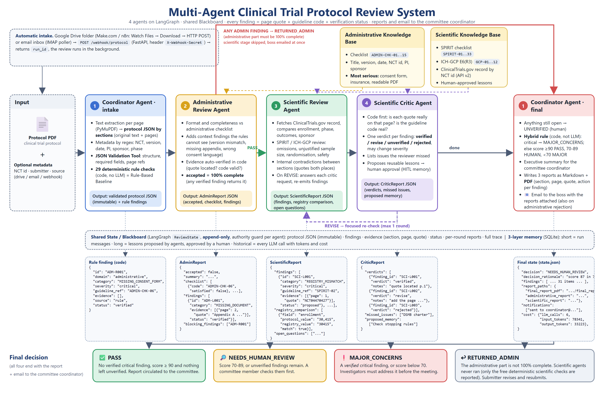

# Project Charter

## Multi-Agent Clinical Trial Protocol Review System

**BIU DS23 Final Project**  
**Team:** Amir Shmaryahu and Ron Levi  
**Date:** 12 November 2026 | **Version:** 1.8 (second round of human evaluation by Ron: finding correctness, 30 findings of the tool-use system, 40 unmatched verified findings; headline decision taken; business value hypothesis; end-user Gradio product; supersedes v1.7 of 8 November 2026, which added the agent-failure rule, row 0, bootstrap uncertainty and the tool-use rows 2', 3', 4')  
**Repository:** github.com/AS-ai25/ProtocolReviewAI (private)

---

## 1. Problem and Users

Helsinki (IRB / ethics) committee coordinators and professional committee members review complex clinical trial protocols before committee deliberation. The review has two distinct parts: an administrative check (is the submission complete, correctly formatted, with every required document and section) and a scientific check (is the methodology sound, internally consistent, and aligned with the trial registry and with SPIRIT / ICH-GCP expectations). The process is time-consuming and vulnerable to missed findings and human error.

The system supports, but does not replace, professional committee review. Its users are the committee coordinator ("the boss"), who receives every result by email, and committee members, who receive reports in which every finding is traceable to a page, a quote and a guideline item.

## 2. Success Criteria and Evaluation

The system is evaluated on a labeled test set that includes ordinary cases, conflicting information, and cases without a valid resolution.

**Primary metric (locked, 20 October 2026).** *Precision of verified findings against blind human labels on the real-protocol test set*: of the findings the system reports as `verified`, the share that a human labeler, working without seeing the system's output, also recorded as a genuine finding. Its companion metric is the *recall of labeled findings* (coverage): the share of human-labeled findings matched by any finding the system reported, verified or unverified. Unverified findings are the system's hand-offs to a human; they are counted separately and are never scored as claims. Rejected and withdrawn findings are not predictions.

**Finding-matching rule (locked).** A predicted finding matches a labeled finding when the domain (administrative / scientific) is the same **and** either (a) the categories are the same or aliases of each other in the team's category alias map (`eval/category_aliases.json`), **or** (b) the guideline reference (SPIRIT / ICH-GCP / ADMIN-CHK code) is the same and the cited page is within ±1 of the labeled page. The rule is implemented once (`eval/matching.py`) and used by every evaluation script.

*Amendment (v1.5, 29 October 2026).* For the generic categories (`OTHER`, `INTERNAL_CONTRADICTION`, `METHOD_UNSPECIFIED`, `SAFETY_GAP`, `ETHICS_GAP`, `CONSENT_GAP`, `FORMAT_ISSUE`, `MISSING_SECTION`) branch (a) also requires the page within ±1. The real-protocol labels use these categories for about 60% of the findings, and without the page requirement a single generic prediction would match every such label in the document. Labels that carry no page (the synthetic cases) keep the category-only behaviour. The amendment makes the scores more conservative, never more generous.

**Evaluation scope (v1.5, reduced-scope plan applied).** Internal committee comments from Sheba could not be obtained and no clinical expert was available to adjudicate labels before Checkpoint 2. The team therefore applied the reduced-scope plan of section 6: five real protocols labeled blind by Ron (46 findings), restricted to **objective findings verifiable directly against the protocol text and SPIRIT 2025** (missing items, internal contradictions between sections, unspecified methods). Findings that require clinical judgement are not labeled and, when the system reports them, are presented as "requires expert verification" rather than as verified claims. Scores are reported on this set, with the synthetic cases shown separately as a harness check and never pooled with the real set.

**Checkpoint 2 result (run 29 October 2026, re-scored 30 October after the labeler's domain correction; `reports/results.md`, reading in `reports/CP2_SUMMARY.md`).** Scientific view (37 labels): full system precision of verified findings 34% (38/112), recall 78% (29/37); single LLM call baseline 25% / 46% (re-scored 4 November after the sub-item guideline-code fix, see section 8; 18% / 46% before). All-domain view (46 labels): 23% / 74% vs 18% / 46% (13% before). The +5 pp margin over the baseline is met (+9 pp scientific, +5 pp all-domain) with a large recall gain; the recall target is narrowly missed (78% vs 80%) and the precision target is not met. Label-matching precision counts every unlabeled verified finding as a false positive, so it does not measure whether those findings are right. **30-finding human evidence check (completed 4 November 2026, Ron; `eval/human_check/`):** of 30 verified full-system findings, the cited passage supports the finding in 1 (yes), partly in 5, and not in 24 (80%). The reference target of this section is therefore **not met**; the two measures sample different things and are reported side by side, never pooled (`reports/CP2_SUMMARY.md` section 2b).

**v1.7 run (8 November 2026, stamp `20261108-154153`, knowledge base kb-v2; `reports/CP2_SUMMARY.md` section 8).** The three tool-use configurations were run on the same five protocols and scored with the same rule, next to the frozen rows (not instead of them). Scientific view: 2' single agent with tool use 29% / 49% (unverified 33), 3' full system without the critic, reviewer with tool use 31% / 65% (47), 4' full system with tool use 36% / 70% (113). Row 0, rules only, computed from the rule findings saved with every run: 6% / 3% (1 of 37 labels). A protocol-level bootstrap (B = 2000) gives every row a 95% interval and every gap a P(gap <= 0): the recall gaps of row 4 over rows 1, 2 and 3 hold (P <= 0.01); the precision gap of row 4 holds against row 2 (P = 0.00) but not against row 1 (P = 0.07); no precision gap involving the tool-use rows is distinguishable from noise (4' vs 4: +2 pp, interval -18 to +20); the recall of 4' is below row 4 in every resample (-8 pp). The tools moved findings from `verified` to `unverified` (36 verified scientific findings in 4' against 112 in row 4) rather than raising label-matching precision, at 2.9x the tokens of row 4. Rows 1-4 remain the headline result until the second human evidence check, drawn from row 4', says whether the demoted findings were the unsupported ones.

**Human evaluation, round 2 (Ron, 12 November 2026; `eval/human_check/HUMAN_CHECK_ROUND2_SUMMARY.md`, reading in `reports/CP2_SUMMARY.md` section 9).** (a) Evidence support of 30 verified findings of row 4': 1 yes / 12 partly / 17 no, against 1 / 5 / 24 for row 4 (yes or partly 43% against 20%, Fisher p = 0.095). The gain is in the administrative findings (9 of 13 against 2 of 10), which come from the deterministic evidence floor; the scientific findings are unchanged (4 partly of 17 against 4 partly of 20). The criterion written before the check (at least 15 of 30) is not met. (b) Finding correctness regardless of the quote, the mentor's question: row 4, 1 yes / 10 partly / 11 no / 8 cannot tell; row 4', 4 / 7 / 14 / 5; equal overall (11 of 30), better for administrative and worse for scientific findings in row 4'. (c) 40 verified scientific findings of row 4 that match no blind label: 31 true but unlabeled, 5 wrong (three of them rule findings), 4 cannot tell, no duplicate. The two measures (b) and (c) do not agree with each other and are reported side by side, with the labeler's audit of 14 flagged findings (`eval/human_check/HUMAN_REVIEW_PRESUBMISSION_AUDIT_REVISED.md`); single annotator, not blind at this stage, no clinical adjudication. **Row 4 stays the headline result; row 4' is reported as the improvement built after the mentor's comments.**

**Targets (planned, measured on the five-protocol real set in `reports/results.md`):**

- Precision of verified findings of at least 0.80, with recall of labeled findings of at least 0.80, on the real-protocol test set.
- Improvement of at least 5 percentage points in precision of verified findings over the Single LLM call baseline (row 2 of the ablation below) at equal or better recall.
- Human check of 30 verified findings, sampled across protocols: for each, the cited passage (page and quote) supports the finding. The result is reported as the share of the 30 that pass, with the failures listed.

**Baselines.** (The second baseline was called "Single-Agent Baseline" until v1.6; renamed on 8 November 2026 after the mentor's remark: one LLM call with the tools' outputs pre-computed by code is a model call, not an agent.) Two baselines are implemented in the same repository and emit the same finding format and decision vocabulary as the multi-agent system:

- *Rule-Based Baseline:* the 29 deterministic checks alone (no LLM).
- *Single LLM call baseline:* one LLM call that receives everything the multi-agent system has (protocol text, both knowledge bases, rule findings, registry record), without a critic and without a revision round.

**Metrics.** The primary metric and its companion (above); the unverified count per protocol; F1 for continuity with Checkpoint 1; runtime; cost (LLM calls and input / output tokens per protocol); and the separate contribution of the critic (findings rejected or downgraded by the critic, and how many of those were indeed wrong).

**Evaluation gate bypass.** In production the scientific agents do not run when the administrative gate fails. Public protocols almost never include consent forms, insurance certificates or signature pages, so nearly every real test protocol is RETURNED_ADMIN and the scientific findings would never be produced. The evaluation therefore runs with `force_scientific`: the scientific stage runs regardless of the administrative result, the findings are produced and scored, and the decision rule is unchanged (still RETURNED_ADMIN when the administrative part is incomplete). Reports mark such runs explicitly.

**Ablation (same test set, same matching rule, all rows with the gate bypass).** Each row reports precision of verified findings, recall of labeled findings, unverified count, LLM calls, input / output tokens and runtime (`eval/ablation.py` → `reports/results.md`):

| # | Configuration | What it isolates |
|---|---|---|
| 1 | Single agent **without** code verification (the model's own status stands) | how many of a single model's claims a human would have to re-check |
| 2 | Single agent **with** the same code verification (quote located in the PDF, guideline code valid) | the value of deterministic evidence verification alone (= Single LLM call baseline) |
| 3 | Full system **without** the critic (administrative agent + scientific reviewer, code-only verification, no revision round) | the value of splitting the review between specialised agents |
| 4 | Full system (four agents, critic verdict per finding, one revision round) | the critic's contribution (row 4 vs row 3) |
| 0 | Rules only (29 deterministic checks, no LLM; v1.7, computed from the rule findings saved with every run) | why not deterministic only (mentor M9): the rules give the administrative gate, not the scientific recall |
| 2' | Single agent **with tool use** + the same code verification (v1.7: the model calls `search_protocol`, `get_page`, `get_section`, `registry_field`, `kb_lookup`, `power_calc` itself, at most six calls, then the deterministic verification runs) | one agent with tools: the fair baseline for row 4' (mentor: a model that chooses no tool is not an agent) |
| 3' | Full system without the critic, **reviewer with tool use** (v1.7) | tool use inside the reviewer alone (3' vs 3) |
| 4' | Full system, **reviewer and critic with tool use** (v1.7) | four agents with tools against one agent with tools (4' vs 2'), and tool use against the frozen full system (4' vs 4) |

Rows 1-4 are frozen (run of 29 October, knowledge base kb-v1, v1.6 code) and are never re-run; the primed rows are the v1.7 code with kb-v2, run on 8 November, and are reported next to the frozen rows. Every row carries a protocol-level bootstrap interval (`eval/rescore.py --bootstrap`).

**Lessons from the first live comparison (16 October 2026, synthetic cases only).** Matching findings by exact category string was too coarse: the LLM uses generic categories where the rules use specific ones, and many "extra" LLM findings were real but unlabeled. The matching rule above and the verified-only scoring answer (a) and (b); (c), labeling real protocols with all defensible findings, including those only an LLM can see, is Ron's Checkpoint 2 deliverable.

## 3. Data and Fallback Plan

**Sources.** Publicly available English-language clinical trial protocol PDFs and structured study metadata from ClinicalTrials.gov (API v2), retrieved by NCT ID.

**Planned scope.** 10 to 15 initial protocols divided between development and evaluation; a labeled set of findings including documented synthetic test scenarios. Two synthetic protocols (one complete, one with ten documented injected deficiencies) already exist for development and tests.

**Real-protocol set (v1.5).** 19 public protocol PDFs sourced by Ron, all "Study Documents" attached to ClinicalTrials.gov records with an Israeli site or investigator (`eval/protocols/SOURCES.md`, `protocol_sources.csv`). Each file was compared byte-for-byte with the registry's copy. Split: 3 development protocols (smoke test on real documents, not prompt tuning) and 16 evaluation protocols; the administrative gate returns 18 of 19 (`eval/protocols/GATE_CHECK.md`), which is why the evaluation runs with the gate bypass. Five evaluation protocols are labeled for Checkpoint 2 (`nct01977547`, `nct04084990`, `nct05199324`, `nct05698277`, `nct06846736`; one of them, `nct05698277`, is an observational study to which the randomisation items of SPIRIT do not apply). Rules-only label drafts (`eval/labeled_cases/_drafts/`) helped with the administrative part; the scientific pass was done blind against the PDF.

**Knowledge base.** SPIRIT 2025 checklist (`spirit_2025_items.json`, 34 items with sub-items), ICH-GCP E6(R3) key points, and an administrative intake checklist (15 items, ADMIN-CHK-01 to 15). Versions are tracked in `knowledge_base/VERSION.md`: **kb-v1** (team draft, tag `kb-v1`) is the version every evaluation result in this charter was run with; **kb-v2** (4 November 2026, tag `kb-v2`, Ron) keeps every identifier and its order and adds source-attributed applicability guidance per code and per study design (interventional, observational, retrospective, questionnaire, AI model), the protocol-only versus submission-package distinction, and the source hierarchy (Israeli MoH Procedure 14, Declaration of Helsinki 2024, ICH E6(R3) and E8(R1), SPIRIT 2025, STROBE). No metric is attributed to kb-v2 until a run is made with it.

**Availability and permissions.** All documents are public registry uploads; 16 of 19 nevertheless carry a sponsor confidentiality header. The repository therefore stores links, the source table and a download script (`eval/protocols/fetch_protocols.py`), not the PDFs. Evaluation outputs quote at most short passages.

**Fallback.** If suitable documents are insufficient, use publicly accessible protocols from PubMed Central and guideline-based synthetic cases, limiting evaluation to verifiable findings.

## 4. Architecture

The system has **four agents** on LangGraph with a shared state ("Blackboard"):

| # | Agent | Role | Output |
|---|---|---|---|

| 1 | **Coordinator** | Single point of contact between the human coordinator and the agents. Intake: extracts protocol text per page and metadata using regex (NCT ID, version, date, PI, sponsor, phase); structures the protocol content into a categorized JSON organized by sections, preserving the original text and page references. Runs a JSON Validation Tool to verify structure, required fields, and consistency before handoff to the Administrative Review Agent. Also executes the 29 deterministic checks. Final: determines the outcome, writes the executive summary and three reports, and emails the committee coordinator. | ReviewState (structured and validated JSON), rule findings, FinalSummary, reports, email |
| 2 | **Administrative Review Agent** | Checks format and completeness against the administrative checklist and the human-approved lessons in memory; adds context findings the rules cannot see (version mismatch between pages, appendix referenced but missing, consent form in the wrong language). Evidence is verified in code. | AdminReport (accepted, checklist, findings) |
| 3 | **Scientific Review Agent** | Fetches the ClinicalTrials.gov record and compares it with the protocol; reviews against SPIRIT / ICH-GCP; detects internal contradictions between sections. On a revision request it answers each critic point and re-emits its findings. | ScientificReport (findings, registry comparison, open questions) |
| 4 | **Scientific Critic Agent** | Audits every reviewer finding. Code first (is the quote on that page? is the guideline code real?), then one verdict per finding: verified / revise / unverified / rejected, with optional severity change. Lists issues the reviewer missed. Proposes reusable lessons for human approval. | CriticReport (verdicts, missed issues, proposed memory) |

**Flow.** PDF arrives (Google Drive or email automation → FastAPI webhook, or IMAP poller) → Coordinator intake (structured protocol JSON) → JSON Validation Tool (invalid → RETURNED_ADMIN at once) → Administrative Review. If the administrative part is not 100% complete, the Coordinator finalizes immediately (decision RETURNED_ADMIN) and emails the boss; the scientific agents do not run. Otherwise Scientific Review → Scientific Critic, with at most one focused revision round, → Coordinator final → reports → email. The boss receives an email in every case. Three evaluation-only switches exist in code and are never used in production runs: `force_scientific` (gate bypass, section 2), `no_critic` (ablation row 3: the reviewer's findings go straight to finalisation with code-only verification) and `tool_use` (v1.7, rows 2', 3', 4': the reviewer, the critic and the single agent may call the protocol-search, page, section, registry, knowledge-base and sample-size tools themselves, at most six calls per LLM call; the deterministic verification still runs after the tool loop and a tool call never replaces it).

**Design change from v1.1.** v1.1 listed a fifth agent, an Administrative Critic. The team decided to keep four agents: administrative completeness is a technical check, and automatic evidence verification in code (quote located in the PDF, guideline code valid) is deterministic, free and sufficient for it. An LLM critic is kept only for the scientific part, where judgement is needed.

**Evidence tools (v1.7, 8 November 2026).** Written once in `tools/evidence_tools.py` and applied in every configuration: at intake the Coordinator builds a numbers table (sample sizes, percentages, durations, dates per page) and a study-design summary (randomised / blinded / observational, with the SPIRIT items that do not apply), both given to every agent; the deterministic verification of a finding now also runs an absence search over the whole protocol for "missing X" claims (a claim whose topic is described on another page is never verified), a mention-is-not-evidence rule (a quote that only names the topic does not support a deficiency), a category-to-guideline-code fit, and a duplicate merge (the later duplicate is rejected, never deleted). These checks are a floor (`agents/base.code_status`): the critic can demote a finding but cannot verify one the code has demoted. Rule findings quote a full sentence and skip contents-page lines.

**Shared State / Blackboard.** The Coordinator creates a structured, validated JSON representation of the protocol within the LangGraph ReviewState, including study metadata, original text organized by sections, and page-level references. This shared state accompanies the protocol throughout the workflow. Each agent reads the relevant information and appends its own structured review results (administrative findings, scientific findings, critic verdicts) without overwriting the original protocol data or previous agent outputs. Deterministic validation checks the JSON schema and source references before administrative review, while handoff validation checks required fields before subsequent stages. Findings include page references, verbatim quotes, guideline references, severity and verification status. The final Coordinator uses the accumulated state to determine the outcome and generate reports. The state and execution trace are persisted per run in SQLite. Implementation: findings a reviewer drops in a revision round are kept with status WITHDRAWN, every review round's report is appended to a list, and a code-level authority guard rejects any node that writes outside its permitted fields (the protocol data is writable only at intake).

**Three-layer memory.**

- *Short:* the agents' messages on the Blackboard per run (purged after 7 days).
- *Long:* lessons proposed by agents; a human approves, edits or rejects them through the API; only approved lessons are injected into prompts.
- *Historical:* every LLM call with model, tokens, duration and output, for audit, cost tracking and evaluation.

**Outputs and Reporting.** The Coordinator generates reports from the validated, accumulated ReviewState. Each report includes study metadata (protocol ID, NCT ID, title, sponsor, PI, phase, version and review date), final decision, score when applicable, and actionable findings. Each finding contains its ID, review category, severity, verification status, protocol section and page, verbatim quote, relevant guideline reference, explanation and required action. Missing metadata is flagged rather than invented. Outcomes are PASS, NEEDS_HUMAN_REVIEW, MAJOR_CONCERNS or RETURNED_ADMIN. Reports are produced as Markdown and PDF (final, administrative and, when the scientific stage ran, scientific) and emailed to the committee coordinator with the PDFs attached; the system does not grant ethical or scientific approval.

## 5. Decision Rules and the Agent's Role

**Administrative rule (decided).** The administrative part must be 100% complete. Any verified administrative finding, critical, major or minor, is written to the report and the submission is returned (RETURNED_ADMIN). Only informational notes let a submission through. The most serious items (consent form, insurance / indemnity, readable complete PDF) are listed first.

**Scientific Decision Rule (decided: Hybrid).** Any verified critical scientific finding results in MAJOR_CONCERNS regardless of score. Otherwise, the derived score determines the outcome: 90–100 PASS, 70–89 NEEDS_HUMAN_REVIEW, and 0–69 MAJOR_CONCERNS. Unverified findings require human review and prevent automatic PASS. If multiple conditions apply, MAJOR_CONCERNS takes precedence. Thresholds are configurable.

**Derived Score.** The score starts at 100, deducting 25 points per verified critical finding, 10 per verified major finding, and 3 per verified minor finding, with a minimum of 0. Unverified findings are excluded from deductions but remain flagged for human review. Each deduction is traceable to a finding ID. The score is used in the hybrid decision rule.

**Decisions beyond ordinary code.** Agents interpret protocol meaning, detect inconsistencies across sections, and determine context-dependent checks. The Coordinator routes and bounds re-checks. The Scientific Critic verifies evidence and challenges insufficiently supported conclusions. Deterministic checks remain in code.

**Agent Guardrails and Decision Authority.** Each agent has a restricted role, tool access and permitted ReviewState fields. The Coordinator manages intake, routing, validation, reporting and applies predefined decision rules; it cannot independently judge scientific validity, alter reviewer findings or override validation failures. The Administrative Agent checks submission completeness only. The Scientific Reviewer identifies potential scientific issues, while the Scientific Critic independently verifies evidence and evaluates findings. Original protocol data is immutable. Deterministic code enforces schema validation, handoff conditions, bounded revisions and decision thresholds. All decisions are traceable, and final professional approval remains human.

**Tools.** PyMuPDF for text extraction; regex metadata; 29 deterministic checks (administrative 14, scientific 12, registry 3); ClinicalTrials.gov API v2 client; knowledge-base loader with keyword retrieval; fuzzy quote verifier; Anthropic SDK with structured outputs (every agent returns a validated schema); LangGraph for state, handoffs and conditional routing; FastAPI webhooks; SMTP; SQLite.

**Failure handling.** Invalid structured output is retried once with the error; model refusals are handled with server-side fallbacks; an LLM failure degrades to deterministic results, is listed in the report and (v1.7, mentor finding M1) caps the decision: when any agent did not run, the outcome is NEEDS_HUMAN_REVIEW at most, never PASS, the summary opens with a warning naming the agent, and `agent_failures` is stored with the run and shown on the dashboard; a finding whose quote is not located in the PDF is never verified, whatever the critic says; the revision loop is bounded; anything still open at finalisation becomes UNVERIFIED and goes to a human; a full trace is kept.

## 6. Risks and Reduced-Scope Version

- **No professional ground truth.** Public protocols may not contain verified findings. Mitigation: labeled test cases, documented synthetic errors, professional validation where feasible.
- **Incorrect or unsupported findings.** LLMs may misinterpret documents or invent details. Mitigation: required citations verified in code, knowledge-base codes validated, independent scientific critic, human review of unverified conclusions.
- **No measurable multi-agent benefit.** The first synthetic comparison could not separate the single agent from the multi-agent system on F1; the multi-agent system costs about five times more (≈110k vs ≈20k tokens per protocol) and its added value is the verification layer. Mitigation: the Checkpoint 2 evaluation measures verified-only precision and the critic's contribution, not raw F1 alone.
- **Draft knowledge base.** Mitigation: verification against SPIRIT 2025 and the committee SOP before Checkpoint 2.
- **No clinical expert for the labels (materialised, October 2026).** Sheba's internal committee comments were not released and the research-authority professor was unavailable. Mitigation applied: labels restricted to objective, text-verifiable findings (section 2); findings needing clinical judgement are reported as "requires expert verification"; the limitation is stated in every results table.
- **Small labeled set (five protocols, 46 findings).** Scores are reported per protocol as well as pooled; differences of a few points between ablation rows are not claimed as significant.

**If only two weeks remain:** keep the system as it is today (29 deterministic checks, four agents, one revision round, both baselines, reports and email) and reduce the *evaluation* instead: fewer real protocols (five instead of 10–15), labels for the scientific part only where the administrative documents are absent, the ablation on that smaller set, and the 30-finding human check reduced to 15. Deferred: knowledge-base expansion, interface work, the administrative critic. Nothing already built is removed.

## 7. Milestones and Team Hats

| Date | Milestone and expected deliverable | Status |
|---|---|---|
| 4 Oct 2026 | Project Charter v1.0: problem, architecture, data, metrics, baselines. | done |
| 13 Oct 2026 | Charter v1.1 (editorial revision). | done |
| 18 Oct 2026 | **Checkpoint 1:** end-to-end pipeline (intake, extraction, checks, reports, email), Rule-Based Baseline; in addition the full four-agent workflow, Single LLM call baseline, evaluation harness, automated tests, first live runs. Charter v1.2. | done |
| 19 Oct 2026 | Charter v1.3 implemented: structured protocol JSON + JSON Validation Tool, append-only state, PDF reports with section/page/quote/action per finding, agent authority guard, hybrid decision rule (26 automated tests). | done |
| 20 Oct 2026 | Mentor review of v1.3 (Shlomit Levavi). Charter v1.4: primary metric and matching rule locked, ablation plan, reduced scope corrected. Code: evaluation gate bypass, critic / verification ablation switches, `eval/ablation.py` → `reports/results.md`, shared matching rule (31 automated tests). | done |
| 30 Oct 2026 | **Checkpoint 2:** 19 real public protocols wired in (source table, gate check, download script); five blind-labeled protocols (46 findings, Ron); live four-row ablation on that set (`reports/results.md`); 30-finding human-check sheet generated (Ron fills it for the mentoring session); charter v1.5 (45 automated tests). Knowledge-base verification in progress (Ron); one-minute recorded demo pending. | done (demo + KB sign-off pending) |
| 1 Nov 2026 | Pre-mentoring submission: repository frozen (commit `1f8c569`: live dashboard with trace, metrics and logs; full Hebrew guide), draft presentation. | done |
| 4 Nov 2026 | Ron's deliverables integrated in separate commits: knowledge base kb-v2, filled 30-finding human check (1 yes / 5 partly / 24 no), evaluation and ablation analyses, charter audit. Sub-item guideline-code bug found while testing kb-v2 and fixed; rows 2 and 3 re-scored from the saved outputs (no new LLM calls). Charter v1.6 (54 automated tests). | done |
| 8 Nov 2026 | Mentoring session (Shlomit Levavi): findings M1-M13 recorded with priorities in `docs/PLAN_V1.7_TOOLS.md`. Same day: M1 fixed (an agent failure never ends in PASS), M9 (row 0, rules only) and M2 (protocol-level bootstrap, gaps against both baselines) added to the evaluation; v1.7 evidence tools and LLM tool calling built, tested and run live as rows 2', 3', 4' on the five labeled protocols (57 min, 5.4M input tokens); eight-row table with uncertainty in `reports/results.md`, reading in `reports/CP2_SUMMARY.md` section 8. Charter v1.7 (65 automated tests). | done |
| 12 Nov 2026 | Final submission: evaluation versus both baselines, README, documented results. Ron's second round of human evaluation integrated in her commits (finding correctness, 30 findings of row 4', 40 unmatched verified findings, audit, crosscheck), business value hypothesis, end-user Gradio product (`gradio_app.py`). Headline decision taken (row 4). Charter v1.8 (65 automated tests). Presentation in preparation (Ron). | done (presentation pending) |
| 15 / 18 Nov 2026 | Project presentation: demonstration, metrics, justification of the multi-agent design. | planned |

**Ron — Product & Data:** requirements and use cases; sourcing and verifying documents; verifying the knowledge base (SPIRIT 2025, ICH-GCP, committee SOP); preparing labeled cases; defining success metrics; assessing finding quality.

**Amir — Agent & Model:** agent architecture and tools; state and handoffs; baseline implementations; guardrails; evaluation runs.

**Shared:** integration, system testing, results analysis, code documentation, final presentation.

## 8. Changes since v1.1

| Area | v1.1 | v1.2 / v1.3 |
|---|---|---|
| Agents | five (incl. Administrative Critic) | four; administrative evidence verified in code |
| Administrative rule | not specified | 100% complete or RETURNED_ADMIN |
| Scientific rule | PASS / REVISE / UNVERIFIED | Hybrid rule adopted: verified critical findings override score thresholds; unverified findings require human review |
| Score | none | Derived score used for hybrid decision-making |
| Baselines | planned | both implemented in the repository |
| Memory | not specified | three-layer memory with human-in-the-loop approval |
| Intake / output | not specified | Drive / email automation → webhook; reports + email to the coordinator in every case |
| Evaluation | F1 vs baselines | plus verified-only precision, critic contribution, semantic matching |
| Protocol representation (v1.3) | page text | structured JSON by sections with original text and page references; JSON Validation Tool before administrative review |
| State discipline (v1.3) | implicit | append-only: withdrawn findings kept, per-round reports, authority guard per agent |
| Reports (v1.3) | Markdown | Markdown + PDF; each finding with section, page, quote, explanation, required action |
| Primary metric (v1.4) | F1 ≥ 0.80 | precision of verified findings against blind human labels, with recall of labeled findings; unverified counted separately |
| Matching rule (v1.4) | exact (domain, category) | domain + (category alias map OR same guideline reference and page ±1) |
| Reference target (v1.4) | 95% valid references | human check of 30 verified findings: the cited passage supports the finding |
| Evaluation runs (v1.4) | production gate | gate bypass for evaluation (`force_scientific`); four-row ablation (`eval/ablation.py`) |
| Reduced scope (v1.4) | "three checks" | the built system stays (29 checks, four agents, one round); the evaluation breadth is reduced |
| Test set (v1.5) | planned 10-15 | 19 public protocols sourced and verified; 3 dev / 16 eval; five labeled blind (46 findings) under the reduced-scope plan |
| Matching rule (v1.5) | category alias alone | generic categories also need the page within ±1; labels without a page unchanged |
| Label scope (v1.5) | all defensible findings | objective, text-verifiable findings only; clinical-judgement findings reported as "requires expert verification" |
| Human evidence check (v1.6) | pending | completed 4 Nov 2026: 1 yes / 5 partly / 24 no of 30 verified full-system findings; reported next to label-matching precision, not pooled; "precision is a lower bound" withdrawn |
| Evidence verification (v1.6) | `[A-D]` sub-item class | bug: `SPIRIT-27b` was read as `SPIRIT-27` (unknown) and demoted to unverified in the code-only rows; fixed 4 Nov (`agents/base.py`, regression test); rows 2 and 3 re-scored from the saved evidence checks against the kb-v1 code set (`eval/rescore.py --kb-codes`): row 2 precision 18% -> 25% (scientific), row 3 26% -> 33%; recall and row 4 unchanged |
| Knowledge base (v1.6) | draft with banners | kb-v2 by Ron: identifiers and order unchanged, applicability addenda and sources; versions and tags in `knowledge_base/VERSION.md`; results stay attributed to kb-v1 |
| Critic contribution (v1.6) | "+8 pp precision" | after the fix, rows 3 and 4 have the same precision (33% vs 34%); the critic's measured contribution is recall (57% -> 78%, revision round) and routing to a human, not precision |
| Decision on agent failure (v1.7) | an LLM failure could end in PASS (mentor M1: invalid API key, zero LLM calls, decision PASS) | any agent that did not run caps the decision at NEEDS_HUMAN_REVIEW; `agent_failures` in state, API and dashboard; the summary and the report open with a warning naming the agent; same rule in the single call |
| Evaluation table (v1.7) | four rows, point estimates | row 0 (rules only) from the saved rule findings; protocol-level bootstrap (B = 2000, seed 20261108) with 95% intervals per row and gaps against rows 1, 2 and 3 with P(gap <= 0) (mentor M2, M9); several runs merged into one table (`eval/rescore.py --stamp a,b`) |
| Evidence verification (v1.7) | quote located + guideline code exists | plus absence search over the whole protocol for "missing X" claims, mention-is-not-evidence rule, category-to-code fit, duplicate merge (rejected, not deleted), numbers table and study design at intake, full-sentence rule quotes that skip the contents page; a deterministic floor the critic cannot override (`agents/base.code_status`) |
| Tool use (v1.7) | every tool runs in code around the LLM call; no agent chooses a tool | `tool_use` switch: the reviewer (`search_protocol`, `get_page`, `get_section`, `kb_lookup`, `power_calc`), the critic (same, with `registry_field` instead of `power_calc`) and the single agent (all six) call the tools themselves, at most six calls per LLM call, results capped at 2,000 characters; every call is stored with the LLM interaction and shown on the dashboard; rows 2', 3', 4' |
| Human evaluation (v1.8) | one evidence check of 30 findings of row 4 (1 / 5 / 24) | plus finding correctness on the same 30 (1 yes / 10 partly / 11 no / 8 cannot tell), both questions on 30 findings of row 4' (evidence 1 / 12 / 17; correctness 4 / 7 / 14 / 5), and 40 unmatched verified findings classified (31 true but unlabeled / 5 wrong / 4 cannot tell / 0 duplicate); counts by `eval/summarize_human_check.py`; the labeler's audit and reference crosscheck in `eval/human_check/` |
| Business value (v1.8) | not quantified (mentor M7) | `reports/BUSINESS_VALUE_HYPOTHESIS.md`: 2-3 combined staff-hours per protocol as a team estimate, workload scenarios, the formula for a pilot; a hypothesis, not a measured saving |
| End-user product (v1.8) | research dashboard only | `gradio_app.py` (Ron): upload a protocol, start the full review, load saved runs, download the report, send it by email only on explicit confirmation; a separate front end on the same FastAPI service, with the evaluation switches hidden; the dashboard stays the tool for inspecting the systems |
| Results (v1.7) | row 4: 34% / 78% (scientific), 50 unverified | rows 2' / 3' / 4' (8 Nov, kb-v2): 29% / 49%, 31% / 65%, 36% / 70%; unverified 33 / 47 / 113; 113 tool calls over 15 runs (search_protocol 96, power_calc 14, registry_field 2, kb_lookup 1); no precision gap involving a tool-use row is distinguishable from noise; 4' recall below row 4 in every resample; 4' uses 2.9x the tokens of row 4. Rows 1-4 stay the headline until the second human evidence check |

## 9. Open Decisions

1. Whether the submitter receives a copy of the administrative report on RETURNED_ADMIN (today: coordinator only).
2. ~~Final list of administrative checklist items against the committee SOP.~~ Decided (v1.6): the 15 ADMIN-CHK items stay as they are; kb-v2 adds the protocol-only versus submission-package guidance and the MoH Procedure 14 source hierarchy instead of new items (Ron, 4 November).
3. ~~Labeling protocol for the real test set~~ Decided (v1.5): Ron labels alone, blind, with page and quote for every finding and a SPIRIT 2025 reference where one applies; no second reader was available, so there is no adjudication step and the labels are reported as single-annotator labels.
4. Category alias map: initial map written by Amir from the deterministic check codes; Ron extends it while labeling. Aliases must stay specific (a generic alias such as MISSING_DOCUMENT would match several labels). Ron's labels used only canonical categories, so no alias was added for Checkpoint 2.
5. Which model and effort setting the ablation is run with (today `claude-opus-5-5`, effort medium); the same setting must be used for all four rows. Applied: all four rows of `reports/results.md` ran with the same model and settings in one session; the v1.7 rows 2', 3', 4' ran with the same model and settings in a second session on 8 November.
6. ~~Whether the 30-finding human check is drawn only from the full system (row 4) or stratified across rows.~~ Decided (v1.5): drawn from the full system (row 4) only, stratified across the five protocols (`eval/make_human_check.py`).
7. ~~Whether to extend the labeled set beyond five protocols before the final submission or to keep five and spend the time on the human check and the knowledge-base sign-off.~~ Decided (v1.6): five kept; the time went to the human check and kb-v2.
8. ~~Whether the evidence text attached to deterministic rule findings (`checks._context`) should be rebuilt: three of the 30 human-checked findings were rule findings whose quote came from the table of contents or was cut mid-sentence (the rule fired on real numbers, the quote did not show them). A fix changes every row of the ablation and needs a new run; deferred to after the final submission.~~ Done in v1.7 (8 November) for new runs: rule quotes are full sentences and skip contents-page lines (`tools/checks.py`); the frozen rows 1-4 keep their old quotes, the primed rows carry the new ones.
9. ~~Whether to add deterministic evidence tools for the critic (absence search over the whole protocol, duplicate detection, per-finding registry check, numbers table) as v1.7, with a re-run of row 4 only. Proposal written 1 November; decided on 1 November: not before the final submission.~~ Reversed and done on 8 November after the mentoring session: built as deterministic evidence tools for every configuration plus LLM tool calling, and run as new rows 2', 3', 4' next to the frozen rows, never as a re-run of row 4 (section 2).
10. ~~Whether row 4' replaces row 4 as the headline result.~~ Decided (v1.8, 12 November): row 4 stays the headline. The second human check found better evidence for administrative findings in row 4' and no gain for scientific findings; the criterion written before the check (yes or partly in at least 15 of 30) was not met (13); label-matching precision is unchanged within noise and recall is lower. Row 4' is presented next to the original experiment as the improvement built after the mentor's comments (Ron's proposal of 10 November). Original text: Deferred to the second 30-finding human evidence check (Ron; `eval/make_human_check.py --stamp 20261108-154153 --row agents_full_tools`, new seed, documented): the tools moved most "missing X" findings to the human queue, which label-matching precision cannot see; only the evidence check can show whether the demoted findings were the unsupported ones. Until then rows 1-4 are the headline and 2'/3'/4' are reported as the v1.7 experiment.
11. Budget before 12 November for the remaining mentor items that need LLM runs: the repeat-run noise experiment (M2c, the same protocol twice on rows 1, 2 and 4), the Sonnet comparison (M8) and the run on the unlabeled protocols (M3). Not run.
