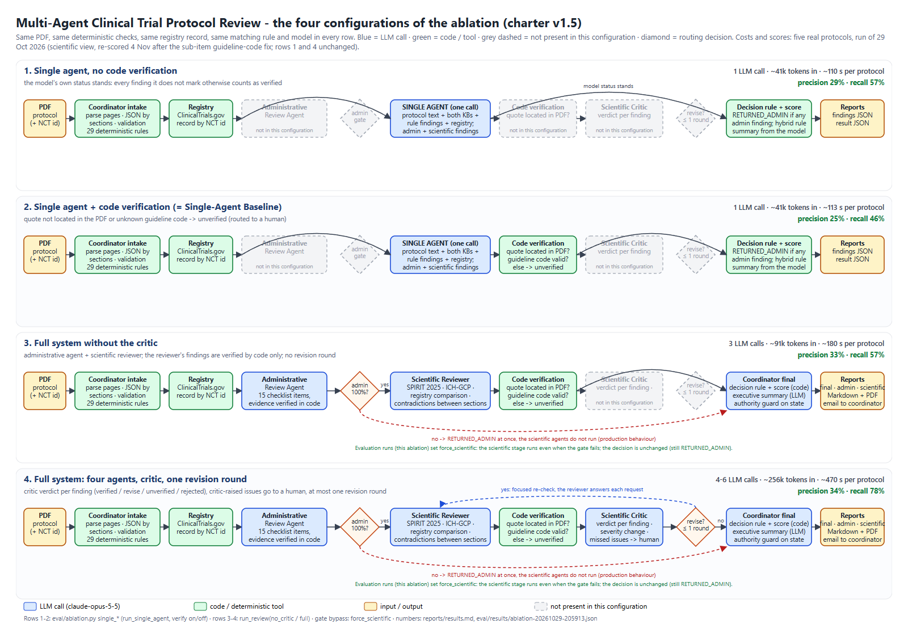

# Checkpoint 2 - evaluation on real protocols: what the numbers say

Companion to `reports/results.md` (generated) - this file is the team's reading of the run of 29 October 2026
(`eval/results/ablation-20261029-205913.json`, model `claude-opus-5-5`, knowledge base kb-v1, five blind-labeled public
protocols, 46 labels, all four ablation rows with the gate bypass). Re-scored views are produced by `eval/rescore.py`
from the saved findings; the LLM outputs were produced once. The tables below are the re-score of **4 November 2026**:
the labeler's domain correction of 30 October (section 2.3) plus the sub-item guideline-code correction of the code-only
rows (section 2.5). The raw table of the live run, scored with the labels as first delivered, is kept in
`eval/results/results_live_raw_20261029-205913.md`; the 30 October re-score in
`eval/results/rescore-20261029-205913-20261101-112300.json`.

Updated 4 November 2026 after Ron's deliverables (knowledge base kb-v2, filled 30-finding human check,
`reports/EVALUATION_AND_LIMITATIONS.md`, `reports/ABLATION_ANALYSIS.md`, `docs/CHARTER_CONSISTENCY_AUDIT.md`).

## 1. Headline numbers

| View | Row | Precision of verified | Recall of labels | Unverified | Tokens in | Runtime |
|---|---|---|---|---|---|---|
| charter (all domains) | 2 Single agent + verification (baseline) | 18% (21/120) | 46% (21/46) | 3 | 207k | 568 s |
| charter (all domains) | 4 Full system | 23% (43/184) | 74% (34/46) | 51 | 1,280k | 2,372 s |
| scientific only (37 labels) | 2 Single agent + verification (baseline) | 25% (17/68) | 46% (17/37) | 0 | - | - |
| scientific only (37 labels) | 4 Full system | **34% (38/112)** | **78% (29/37)** | 50 | - | - |

Before the 4 November correction row 2 read 13% / 46% (all domains) and 18% / 46% (scientific); row 4 is unchanged.

Against the charter targets:

* **Recall of labeled findings >= 0.80: narrowly missed** on the scientific view (78%, 29 of 37; one more match would
  reach it); 74% on the all-domain view. The eight misses are all generic `OTHER` labels (section 3).
* **Precision of verified findings >= 0.80: not met** (23% / 34%). Section 2 explains what this number measures;
  section 2b gives the human evidence check, which is lower still.
* **+5 pp precision over the Single-Agent Baseline at equal or better recall: met** (+5 pp all-domain, +9 pp scientific;
  recall +28 pp / +32 pp). The margin is smaller than reported on 30 October (+10 / +16) because the baseline was
  under-scored by the sub-item code bug (section 2.5).
* **Human check of 30 verified findings (cited passage supports the finding): not met.** 1 yes, 5 partly, 24 no
  (section 2b).
* **Cost:** the full system uses ~6x the input tokens and ~4x the runtime of the single agent per protocol.

## 2. Why precision is low, and what it does and does not mean

1. **The system reports far more than the labeler recorded.** Ron labeled about 9 findings per protocol, restricted by
   design to objective, text-verifiable issues. The full system verifies about 37 per protocol. Every verified finding
   that matches no label counts as a false positive, whether it is wrong or merely unlabeled. Label-matching precision
   therefore measures agreement with a deliberately narrow label set; it says nothing about whether the unlabeled
   findings are right. **The 30 October claim that it is a "lower bound on the true precision" is withdrawn:** the human
   evidence check (section 2b) shows that most sampled verified findings are not supported by their own quote, so the
   true precision cannot be assumed to be higher than the label-matching number.
2. **Administrative package completeness.** Public registry protocols have no consent form, insurance statement,
   signature page or sponsor declaration. The rules and the administrative agent correctly report those absences
   (verified by construction) and the labeler, by the reduced-scope plan, did not label them: 28 of the 72 verified
   administrative findings are of this kind (consent, insurance, signature page, sponsor, ethics statement, referenced
   documents). The scientific-only view removes this artefact. As Ron's analysis states, absence in a public PDF is not
   proof of absence in the hospital submission package.
3. **Domain classification of 16 labels (corrected 30 October).** Sixteen labels on data management, monitoring,
   amendments, confidentiality and the consent process (SPIRIT-26/29/31/32/33) were first recorded as *administrative*;
   the system raises the same issues through the scientific reviewer (e.g. INVEST: `SCI-L015` "Monitoring plan and
   amendment communication lack detail", SPIRIT-29/31, page 27, is label #1 + #3 of that protocol), so under the
   domain-first rule they could not match. The labeler agreed in writing to move the domain of those 16 findings to
   *scientific* - the domain field only; text, quote, category, severity and page untouched, the original value kept
   in `domain_original`, the untouched files in commit `545a516`. The decision was taken before the labeler saw any
   system output; the tables were rebuilt with `eval/rescore.py` (no new LLM calls). Effect on the full system:
   all-domain recall 61% -> 74%, scientific recall 90% (19/21) -> 78% (29/37) because the scientific label set grew
   from 21 to 37 and the system missed 8 of the 16 moved labels' neighbours. The `expected_decision` stays
   RETURNED_ADMIN for every protocol: the decision is the production rule applied to the real document (which lacks
   consent, insurance and signature documents), not a function of the labels.
4. **Generic-category labels.** 60% of the labels are OTHER / INTERNAL_CONTRADICTION / METHOD_UNSPECIFIED. The v1.5
   matching amendment (page required for generic categories) keeps one generic prediction from matching every such
   label at once; it makes the scores more conservative.
5. **Sub-item guideline-code bug (found 4 November, fixed the same day).** `verify_evidence` (`agents/base.py`) read the
   guideline reference with a character class that accepted only upper-case sub-item letters, while the knowledge base
   spells them in lower case: `SPIRIT-27b` was cut to `SPIRIT-27`, an unknown code, and the finding failed the
   "guideline code valid" check. In the two rows whose status is decided by code alone this demoted correctly cited
   findings to *unverified*: 18 of 21 unverified findings in row 2 and 24 of 33 in row 3. The bug was masked for the
   codes that the kb-v1 compatibility list still carried bare (`SPIRIT-14`, `-21`, ...) and surfaced when Ron's kb-v2
   removed that list and three tests failed. Fix: one character class plus a regression test
   (`tests/test_evidence_codes.py`). The rows were re-scored from the saved evidence checks against the kb-v1 code set
   (`eval/rescore.py --kb-codes eval/results/kb-v1-codes.json`; the saved outputs are not modified, the correction is
   applied in memory and recorded in the results header):

   | Row | Precision (scientific) | Precision (all) | Unverified (all) | Recall |
   |---|---|---|---|---|
   | 2 Single agent + verification | 18% -> **25%** (17/68) | 13% -> **18%** (21/120) | 21 -> 3 | unchanged |
   | 3 Full system without critic | 26% -> **33%** (26/79) | 15% -> **20%** (30/150) | 33 -> 9 | unchanged |
   | 4 Full system | 34% (1 finding affected; the critic's verdict stands) | 23% | 51 | unchanged |

   Consequence for the reading: the critic's contribution to *precision* disappears (row 3 vs row 4: 33% vs 34%);
   its measured contribution is recall and routing (section 3).

## 2b. Human evidence check of 30 verified findings (Ron, completed 4 November 2026)

`eval/make_human_check.py` sampled 30 *verified* findings of the full system (row 4), six per protocol, seed fixed
(`eval/human_check/verified_findings_check.csv`). Ron checked each quote on the physical PDF page with its context,
without reading the system's explanation first, and answered one question: does the cited passage support the flagged
issue under the cited guideline item? Summary in `eval/human_check/HUMAN_CHECK_SUMMARY.md`.

| | yes | partly | no |
|---|---|---|---|
| all 30 | 1 (3%) | 5 (17%) | 24 (80%) |
| scientific findings (20) | 0 | 4 | 16 |
| administrative findings (10) | 1 | 1 | 8 |
| LLM findings (27) | 1 | 5 | 21 |
| rule findings (3) | 0 | 0 | 3 |

By category of the 24 "no": METHOD_UNSPECIFIED 6, FORMAT_ISSUE 4, INTERNAL_CONTRADICTION 3, SAFETY_GAP 2,
MISSING_DOCUMENT 2, one each of CONSENT_GAP, ETHICS_GAP, MISSING_SECTION, INCONSISTENT_PHASE, INCONSISTENT_SAMPLE_SIZE,
REGISTRY_MISMATCH, OTHER.

What the failures look like (Ron's notes, paraphrased):

* The quote documents that the topic *exists* in the protocol, not that it is deficient: a "no DSMB" finding quoting the
  sentence that mentions the DSMB; a "version missing" finding quoting the version date.
* The quote is a table-of-contents line or is cut mid-sentence. All three rule findings in the sample fail this way:
  the deterministic check fired on real numbers (two sample sizes, two phases, enrollment vs registry) but the evidence
  text that `checks._context` attached came from the contents page or a figure caption. The finding is defensible, the
  evidence shown is not (charter v1.6, open decision 8).
* The guideline item does not match the claim (SPIRIT-8 dissemination cited for a phase inconsistency).
* RCT-only SPIRIT expectations applied to observational or retrospective designs (ALK digital pathology).

What it means. `verified` in this system means: the quote was located in the PDF, the guideline code exists, and the
critic (row 4) agreed. It does not mean the claim is supported by the quote. On this sample the chain locates text
reliably and judges relevance poorly. The two numbers of this checkpoint therefore describe different failures and are
reported side by side: label-matching precision (34%) says how often a verified finding coincides with the labeler's
narrow label set; the evidence check (3% yes, 20% yes-or-partly) says how often the cited passage actually carries the
claim. Neither can be used to argue that the other is pessimistic.

Consequences drawn: (1) the "precision is a lower bound" reading is withdrawn everywhere (charter v1.6, this file,
demo); (2) the system is presented as a traceable pre-review prototype whose every finding needs a human reader, not as
a verifier; (3) the next engineering step is evidence quality, not more agents: absence search over the whole protocol
for "missing" claims, duplicate detection, per-finding registry checks, a numbers table, and rebuilt evidence text for
rule findings (section 7).

## 3. What the multi-agent design buys (mentor question: "5x cost for a few points - what do you recommend?")



*`docs/ablation_configs.png` (source `docs/ablation_configs.html`): the same pipeline in the four rows of the ablation; grey dashed boxes are absent in that configuration; the red dashed path is the production behaviour of the administrative gate, bypassed in evaluation runs; the blue dashed arrow is the revision round.*

* **Recall.** On the scientific view the full system reaches 78% of the labeled findings (29/37) against 46% for the
  single agent with the same verification. Per protocol: ABC PICU 7/8, SAFER 7/7, INVEST 7/9, fetal cardiac 5/8,
  ALK 3/5. All eight misses are generic `OTHER` labels (data-transfer controls, de-identification timing, consent-role
  wording, missing-value handling, image standardisation): the reviewer either did not raise them or raised them from
  a different page than the labeler quoted (the v1.5 page requirement then counts a miss).
* **Critic.** After the sub-item correction, rows 3 and 4 have the same label-matching precision (33% vs 34%): the
  critic does not filter better than the code check on this set. Its measured contributions are (a) the revision round,
  which lifted scientific recall from 57% (row 3) to 78% (row 4); (b) routing: 50 scientific findings sent to a human
  as unverified instead of 9, and 36 critic-raised issues that are never scored; (c) 3 findings rejected or withdrawn.
  The human evidence check shows that routing is the right direction: most verified findings still need a reader.
  Rows 3 and 4 differ by the critic *and* the revision round together; the design does not isolate the verdicting
  alone (Ron's ablation analysis, point 3).
* **Verification layer.** In row 2, after the correction, 3 of the single agent's 123 findings could not be located in
  the PDF or cited an unknown guideline code and were demoted to unverified (21 before the fix). Rows 1 and 2 are two
  separate model calls, not one output scored twice, so the difference between them (precision 29% -> 25%, recall
  57% -> 46%) mixes the effect of verification with run-to-run variation of the model; a few points between adjacent
  rows are within that noise, the 32-point recall gap between rows 2 and 4 is not.
* **Recommendation (tiered).** Default: single agent + code verification (row 2) for triage at ~1/6 of the cost;
  full system with the critic for protocols that reach the committee (anything not RETURNED_ADMIN, or on request),
  where recall matters more than cost. The administrative gate stays deterministic in both tiers. In both tiers every
  finding, verified or not, is read by a person before it reaches the committee.

## 4. Mentor question: "which of the four is really an agent?"

The Coordinator is an orchestrator (intake, validation, routing, decision rule, reports); it makes no judgement
calls. The Administrative Review Agent, the Scientific Reviewer and the Scientific Critic are LLM agents with a role,
tools, a bounded authority on the shared state and structured outputs; the critic is the only one that argues with
another agent (one revision round). We say so in the presentation rather than inflating the count.

A related question, "why do the agents not call tools themselves": the tools (PDF parsing, the 29 rules, the registry
lookup, the quote and code checks) run in code around each LLM call, always, so verification cannot be skipped by the
model and every row of the ablation has a fixed number of calls. LLM tool calling (the model asking for a page or a
search) is the next step, documented as future work (section 7).

## 5. Limitations to state plainly

* Five protocols, 46 labels, one annotator, no clinical expert adjudication (Sheba's internal comments were not
  released; the research-authority professor was unavailable). Labels are objective text-level findings only.
* Findings that need clinical judgement are not labeled; when the system reports them they are presented as
  "requires expert verification", never as verified claims.
* The 30-finding human evidence check (section 2b) found the cited passage supporting the finding in 1 of 30, partly in
  5. `verified` is a traceability status, not a correctness guarantee.
* One run per configuration (no repeats); differences of a few points between rows are not significant.
* The matching rule was amended for generic categories on 29 October before the run (documented, conservative).
* The domain of 16 labels was corrected after the run but before the labeler saw any output (section 2.3); the raw
  table with the labels as first delivered is kept next to the re-scored one.
* The sub-item guideline-code bug (section 2.5) affected the code-only rows until 4 November; the correction is a
  deterministic re-score, documented in `reports/results.md` and in the charter (v1.6).
* The evidence text attached to rule findings can come from the contents page (section 2b); fixing it changes every
  row and needs a new run.
* All results were produced with knowledge base kb-v1; kb-v2 (Ron, 4 November) has not been run.

## 6. Reproducing

```
python eval/protocols/fetch_protocols.py            # PDFs from ClinicalTrials.gov
python eval/ablation.py --cases-glob "nct*.json"    # live run, ~75 min, ~USD 10 (writes reports/results.md)
python eval/rescore.py --stamp <stamp> --kb-codes eval/results/kb-v1-codes.json   # rebuild the tables from the saved findings, no LLM calls
python eval/make_human_check.py --stamp <stamp>     # 30-finding sheet for the human check
```

## 7. Future work: evidence tools for the agents (not before the final submission)

Decided on 1 November (proposal in the team's notes): no change to the agents before 12 November. The ranked list,
for the presentation's "what we would improve" slide:

| Tool | Agent | Problem it addresses | Evidence |
|---|---|---|---|
| absence search over the whole protocol (keywords per category, model-proposed synonyms) | critic, administrative | "missing X" findings whose quote only shows that X is mentioned; most of the 24 "no" | section 2b |
| duplicate / overlap detection against other findings and rule findings | critic | the same issue reported two or three times inflates the verified count | section 2 |
| per-finding registry field check (enrollment, phase, outcomes) | critic, reviewer | REGISTRY_MISMATCH judged from prose | section 2b |
| numbers and dates table built once at intake | all | internal contradictions across distant pages | ContraDoc, FIND |
| rebuilt evidence text for rule findings | coordinator | contents-page quotes | section 2b |
| protocol search on demand (LLM tool calling, PaperQA2-style evidence gathering) | critic, then reviewer | 60-75k input tokens per call | PaperQA2 |

Literature behind the direction: CRITIC (Gou et al., ICLR 2024: self-critique without tool feedback is unreliable, with
tools it works), Agent-as-a-Judge (Zhuge et al., 2024: a judge with tools agrees with humans 90% vs 70%), PowerGPT
(2025 RCT: keep the LLM out of the arithmetic). Any change to the critic is followed by a re-run of row 4 only;
rows 1-3 stay as the frozen baselines.
